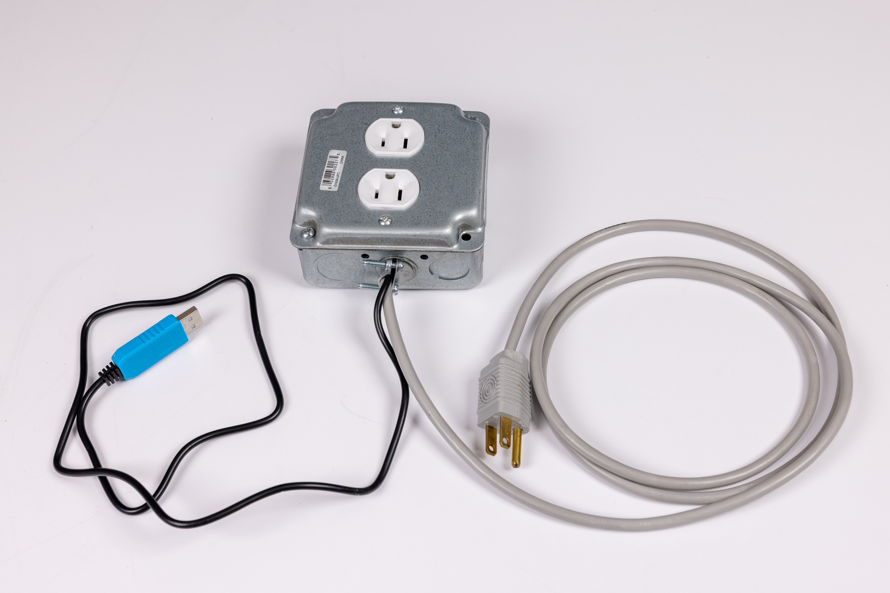
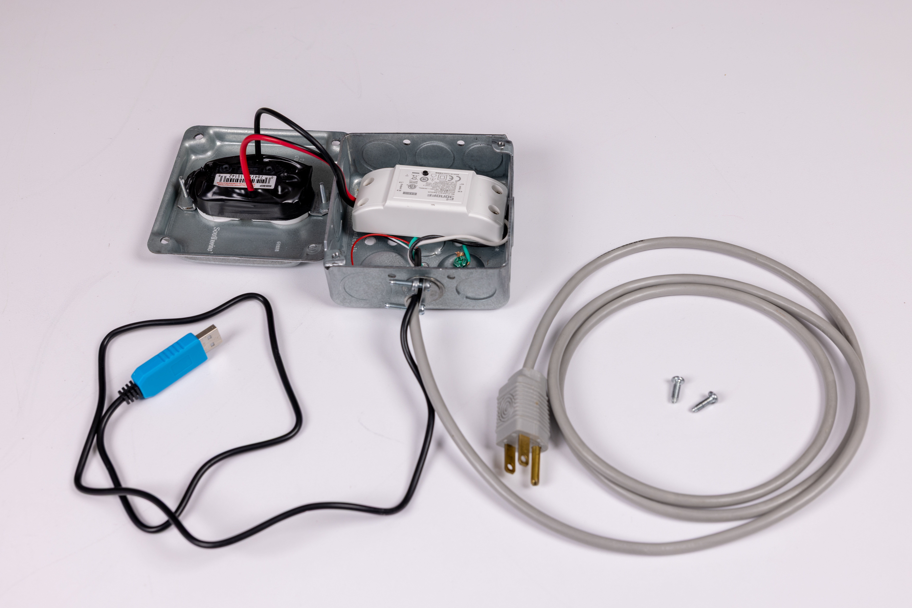
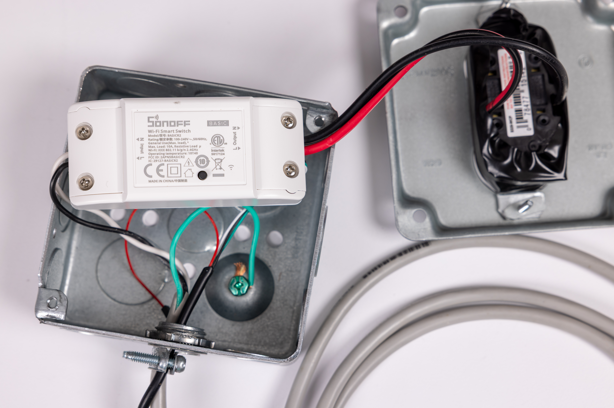
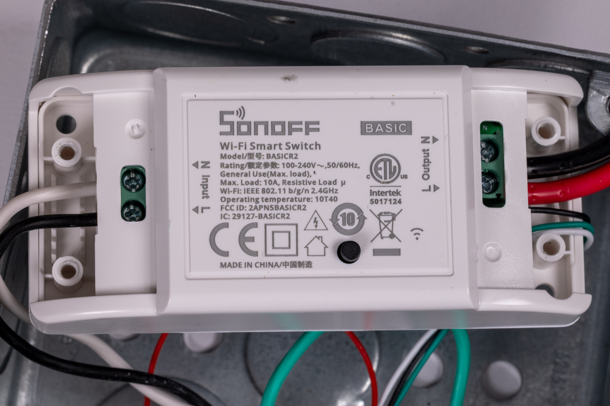
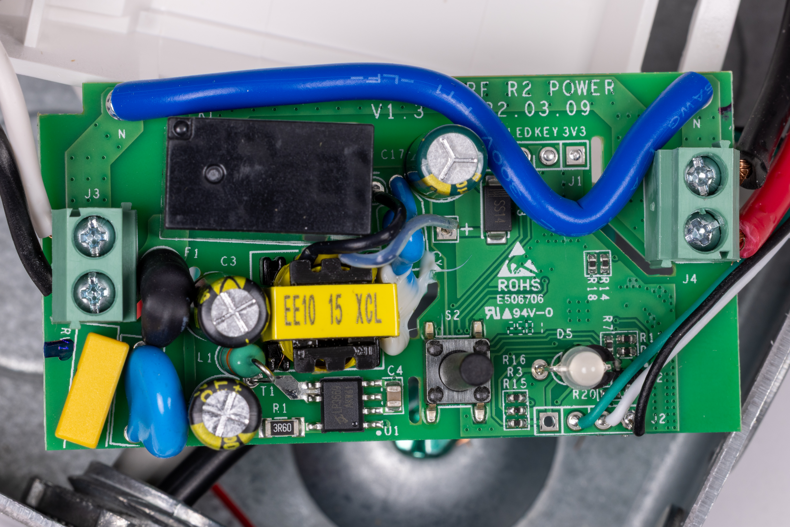
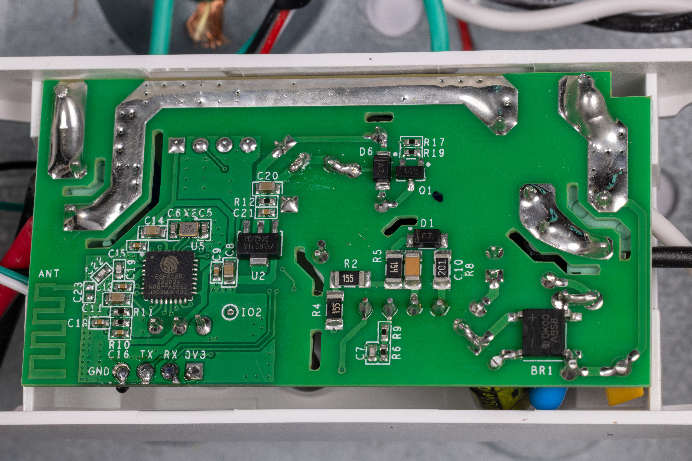
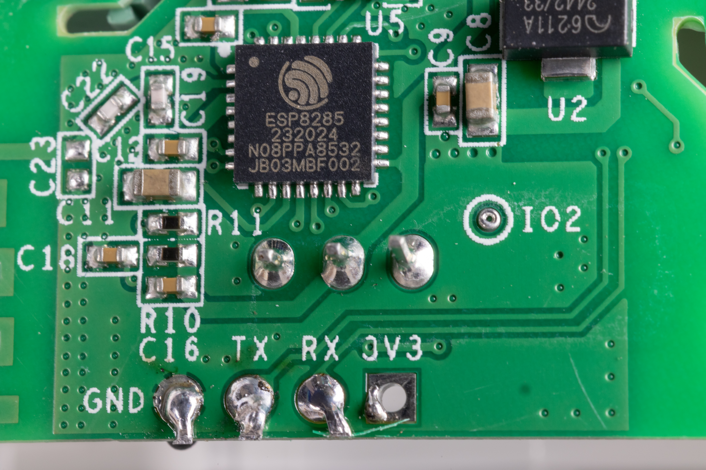

# ezmation-usb-power-switch
Reverse engineering and usage notes for the USB power switch from [EZmation.com](https://EZmation.com)

## Supplied Documentation

The documentation provided by EZmation for their USB-controlled AC power switch is very brief and not entirely applicable to that specific product. No documentation ships with the product, but some info appears on the product's web page. For reference, here is a copy of what appears there as I write this:

> 
```
Upon application of utility power the device will energize the socket and turn the switch LED RED to indicate power is ON
Power may be toggled by pressing the local power button. The LED will go off when power is OFF
Power may also be turned on or off by sending RS232 commands through the DB9 port at 115200 BPS, N81
  ON => Turns the socket on
  OFF => Turns the socket off
  ? => returns current status, ON or OFF

Specifications

Max Load: 10A / 2200 W
Serial Connectivity: USB Virtual COM Port, RS232 @ 115200N81
Firmware Upgrade: Via serial port
Also available with a DB9 serial port.
Hardware/Firmware customizations available upon request.
```

Here's a list of things in the above text that are just wrong:
* There is no LED on the outside of the  device.
* There is no local power button on the outside of the device.
* There is no RS232 or DB9 port on the device. Instead, there is an FTDI USB Type A to async serial adapter. It provides a physical (not virtual) serial port, which is hardwired to the device.

Here's an incomplete list of questions that are not answered by the above text:
* Does the device respond when AC power is not connected?
* What line ending is sent by the device? CR (Mac), LR (Unix), CRLF (DOS)?
* What line endings are accepted by the device?
* What, if anything, does the device send on powerup?
* What, if anything, does the device send in response to ON or OFF commands?
* What, if anything, does the device send in response to erroneous commands?
* How is firmware upgrade accomplished?

## Device Inspection and Teardown

Here's what the device looks like out of the box. We see a generic metal outlet box from China with duplex 3-prong outlets, just like you'd find at the hardware store. We see a generic 3-prong AC power cord. A narrow black cable terminates in a blue housing with a USB Type A plug at one end.



Removing two screws allows us to flip the lid of the outlet box open. Under the lid we see the duplex outlet, wrapped in some electrical tape to keep the bare terminals from shorting to anything inside the box. Remaining in the main box we see a white module. There's nothing else inside.



After pulling out the white module and rearranging things a bit, we can see that two of the wires from the AC power cord (white and black) enter the module on the input side, and the other wire (green) goes to the ground terminal of the metal box. 

Red and black wires leave the module on the output side and supply power to the duplex outlet.

The black cable from the USB connector contains four wires. The red wire doesn't to anywhere; it is terminated in a DuPont connector and is left loose in the box. The other three wires (white, black, and green) go into the module.



Here's a good look at the label on the white module. It's a Sonoff Wi-Fi Smart Switch, model BASICR2, rated for 100-240V AC, 50/60 Hz, 10 amps resistive load. It supports WiFi 802.11b/g/n at 2.4 GHz. Operating temperature range is specified as 10T40 (10 to 40 degrees C). FCC ID 2APN5BASICR2, IC 29127-BASICR2.

The FCC filing includes a rudimentary User Manual for the module, along with photos and other documents. FCC operates a [FCC ID lookup page](https://www.fcc.gov/oet/ea/fccid) where you can search by FCC ID and download any non-proprietary documents related to the filing. However, the [User Manual on the Sonoff web site](https://sonoff.tech/en-us/pages/user-manual) is better.

This module is out of production, replaced by a BASIC R4 version. Nonetheless, as of this writing EZmation has this version offered for sale on their web site for just $9.49.



Inside the module we find a single circuit board. This side of the circuit board contains the AC power handling, along with a small power supply for the digital circuitry, based on an LP3669 switching regulator IC.

We can also see the three wires from the USB connector entering at J2. There's a fourth position on J2, which is unused.

S2 is a pushbutton switch with a tall black button that reaches through the top housing of the module, where it is unlabeled. D5 is an LED. These components are probably what the author of the web site documentation had in mind when mentioning a button and a LED, though there's no provision for either of them to be usable from outside the metal box.



The other side of the circuit board is dominated by the digital circuitry, though it also includes some beefy power traces.

At the lower left we see U5 is an Espressif ESP8285 WiFi System-on-a-Chip, which is essentially an ESP8266 with a megabyte of flash memory built in. The clock crystal is marked 26.000 MHz.

At the edge of the circuit board the pins of J2 are clearly labeled. Pin 1 (the square pad on the right) is the unused position, labeled 3V3 (that is, 3.3 volts DC power). Pin 2 is labeled RX and is hooked up to the green wire from the USB connector. Pin 3 is labeled TX and is hooked up to the white wire. Pin 4 is labeled GND and is hooked up to the black wire. This tells us the architecture of the control port: the blue housing that contains the USB Type A connector must also contain a USB to async serial adapter chip, and the signals traveling within the black wire are async serial data, receive and transmit, very likely at 3.3 volts.

U2 is a MicrOne ME6211A voltage regulator in a SOT89-3 package.

At the lower left corner of the board the WiFi antenna is visible as a wiggly trace in the copper. This USB-controlled power switch product apparently doesn't use the WiFi capabilities of the ESP8285 SOC, but the Sonoff module looks like a cost-effective way to source a microcontroller integrated with a suitable AC power switching relay -- especially if the company got a good deal on a batch of BASICR2 modules after they were replaced by later versions.




## Experimental Findings

### USB Connection (AC Power Disconnected)
When the USB connector on the power switch is plugged in to a computer, it is immediately enumerated as a serial port device, even if AC power is not yet connected to the power switch. This shows that the USB to serial adapter is in the USB connector and not in the Sonoff module. Here is what it looks like to my M4 MacBook Air:

```
FT232R USB UART:

Location ID:	0x01110000
Connection Type:	Removable
Manufacturer:	FTDI
Serial Number:	A5XK3RJT
Link Speed:	12 Mb/s
USB Vendor ID:	0x0403
USB Product ID:	0x6001
USB Product Version:	0x0600
```

With AC power not connected, the serial port does not send any characters, either on powerup or in response to characters sent from the computer. This is consistent with the observation that the red wire, presumably power from USB, is not connected to anything in the power switch. Power for the SOC in the Sonoff module is derived from the AC line, not from USB.

### After Connecting AC Power

When AC power is connected to the power switch, it is immediately passed through to the duplex outlet. This matches the documentation.

On the USB serial port, we see two separate bursts of data at powerup. The first burst is at the unusual baud rate of 74880. Here's what that looks like:

```
ets Jan  8 2013,rst cause:1, boot mode:(3,0)

load 0x4010f000, len 1384, room 16
tail 8
chksum 0x2d
csum 0x2d
v4ceabea9
```

This apparently has something to do with a boot loader. I found hints about this in the [FAQ for Tasmota](https://tasmota.github.io/docs/FAQ/#flashing-issues), an open source operating system for the ESP82xx. It says "If the flash fails or the device does not operate as expected, try using the default ESP82xx boot ROM baud rate - 74880. This is the baud rate the ESP82xx is set to by default when it boots into programming mode."

Then it switches to the documented baud rate of 115200 and sends this signon message:

```
RS232 POWER CONTROL
https://www.irblaster.info V0.2
Supported Commands: ON, OFF, ?
```

If the terminal program is set for 115200 baud when the burst at 74880 baud comes through, and if it is trying to emulate a VT100 or ANSI terminal, it may be confused and display this instead:

```
RS232 POWER CONTROL
␤├├⎻⎽://┬┬┬.␋⎼␉┌▒⎽├␊⎼.␋┼°⎺ V0.2
S┤⎻⎻⎺⎼├␊␍ C⎺└└▒┼␍⎽: ON, OFF, ?
```

The domain name mentioned, [IR Blaster.info](https://www.irblaster.info), is identified on both web sites as a sister site to [EZmation.com](https://ezmation.com).

Both of these messages are sent with CRLF line endings.

### Responses to Commands

Input characters are not echoed.

Commands are accepted with CR, LF, or CRLF line endings.

If the first command you type is invalid (including just an empty line), the power switch will respond with:

```
invalid command
```

However, once the power switch has processed a valid command, that response is no longer generated for most invalid inputs. Instead, it seems to repeat the previous valid command, or maybe it is merely repeating the *response* to the previous valid command.

The `ON` and `OFF` commands (which are indeed case sensitive) generate no response.

The `?` command generates a response of "ON" or "OFF", followed by CRLF.

Any valid command is accepted even if it is followed by extra characters after the command but before the line ending. So `ONatime there were three little pigs` is processed the same as `ON`.

However, as a special case, multiple valid commands on the same line with no characters in between (such as `ON?`, `ONON`, `ONOFF`, `??`, etc. ) still generate an `invalid command` response, and are not processed.
